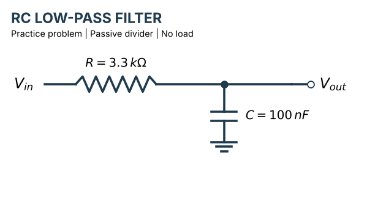
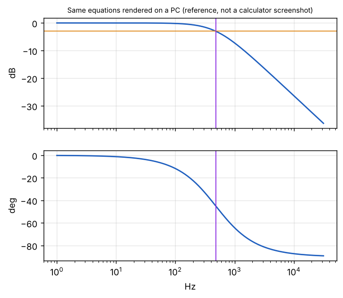

# FILTER — Passive filter frequency response for TI-84 Plus CE

A TI-BASIC program that computes the gain, dB and phase of a **passive voltage-divider filter** `Vin — ZS — Vout — ZP — GND`, where the series arm ZS and the shunt arm ZP are each built from series/parallel R, L and C — for a single frequency, or as a full Bode magnitude + phase plot. It is the companion of [AMPCALC](https://github.com/INLEI12138/ampcalc-ti84) (op-amp circuits).

 一个 TI-84 Plus CE 上的 TI-BASIC 程序,用来计算**无源分压式滤波器** `Vin — ZS — Vout — ZP — GND` 的增益、dB 和相位。串联臂 ZS 和并联臂 ZP 都可以由串联/并联的 R、L、C 组成;可以算单个频率,也可以画幅频 + 相频 Bode 图。它是 [AMPCALC](https://github.com/INLEI12138/ampcalc-ti84)(运放电路)的姊妹程序。

---

## Features

- Transfer function `H = ZP / (ZS + ZP)`
- ZS and ZP each: series R, L, C **plus** a parallel R, L, C branch (12 values in total)
- Menu-driven input with back-edit (view / re-enter any group), and a formula page that recognises RC / RL low-pass and high-pass circuits and prints their cut-off frequency
- Unit suffixes: `10K`, `1UF`, `100N`, `1NH`, `2MEG`, `P N U M K G T` (a trailing `F`/`H` is ignored)
- Single-frequency result: gain, dB, phase
- Bode plot with an auto-suggested frequency range (from detected corner/resonance frequencies up to 10^15 Hz) or a manual range
- The −3 dB level and `F3DB` are measured from the pass-band peak, so they also work for high-pass filters
- Plot annotations: `10^n` axis labels, MAX/MIN, −3 dB line, F3DB; the summary page shows F3DB in scientific notation
- Turns off leftover `Y=` functions before drawing, and unwraps the phase

## 功能

- 传递函数 `H = ZP / (ZS + ZP)`
- ZS 和 ZP 各包含:串联的 R、L、C,**以及**一组并联的 R、L、C(共 12 个数值)
- 菜单式输入,输错可以返回修改;公式页能识别 RC / RL 低通和高通电路,并给出截止频率
- 支持单位后缀:`10K`、`1UF`、`100N`、`1NH`、`2MEG`,以及 `P N U M K G T`(末尾的 `F`/`H` 会被忽略)
- 单频率结果:增益、dB、相位
- Bode 图:根据检测到的转折/谐振频率(最高到 10^15 Hz)自动建议频率范围,也可手动设置
- −3 dB 位置和 `F3DB` 是相对通带峰值计算的,所以高通滤波器也适用
- 图上标注:`10^n` 横轴标签、MAX/MIN、−3 dB 线、F3DB;汇总页用科学计数法显示 F3DB
- 画图前会关闭残留的 `Y=` 函数,相位会自动展开

---

## Install

1. Send `FILTER.8xp` to the calculator with TI Connect CE (or copy `FILTER.txt` into a new program in the TI Connect CE editor and send that).
2. Set **MODE** to `Degree` and `a+bi` (the program sets Degree itself; `a+bi` must be set manually).
3. `PRGM` → `FILTER` → `ENTER`. The main menu has a QUIT option.

> TI Connect CE tip: if the transfer fails with "Calculator is Busy", exit the running program to the home screen first.

## 安装

1. 用 TI Connect CE 把 `FILTER.8xp` 发送到计算器(或者把 `FILTER.txt` 的内容复制到 TI Connect CE 编辑器里新建的程序中,再发送)。
2. 把 **MODE** 设为 `Degree` 和 `a+bi`(程序自己会设置 Degree,但 `a+bi` 需要手动设置)。
3. 按 `PRGM` → 选 `FILTER` → `ENTER`。主菜单有 QUIT 选项。

> TI Connect CE 小提示:如果发送时提示 "Calculator is Busy",请先在计算器上退出正在运行的程序,回到主屏幕再发送。

---

## Usage

1. `1 SERIES ARM ZS`: enter six values — series R, L, C, then parallel R, L, C. Type `0` for anything absent.
2. `2 SHUNT ARM ZP`: the same six values for the arm to ground.
3. `3 VIEW/EDIT` to check or correct a group, `4 FORMULA` for the equations and the filter type, `5 RUN` to calculate.
4. Pick **SINGLE FREQ** or **BODE PLOT** (then AUTO or MANUAL range).

"Series arm" means the part in the signal path between Vin and Vout; "shunt arm" means the part from Vout to ground.

## 使用方法

1. 选 `1 SERIES ARM ZS`:输入六个数值——先是串联的 R、L、C,再是并联的 R、L、C,没有的元件输入 `0`。
2. 选 `2 SHUNT ARM ZP`:对接地的那一支,同样输入六个数值。
3. `3 VIEW/EDIT` 用来检查或修改某一组数据,`4 FORMULA` 查看公式和滤波器类型,`5 RUN` 开始计算。
4. 选择 **SINGLE FREQ**(单频率)或 **BODE PLOT**(Bode 图),Bode 图再选 AUTO(自动)或 MANUAL(手动)范围。

"串联臂"(series arm)是 Vin 到 Vout 之间在信号通路上的部分;"并联臂/分流臂"(shunt arm)是 Vout 到地的部分。

---

## Example

RC low-pass: `ZS = R = 3.3K`, `ZP = C = 100nF`

Enter for ZS: `3300`, then `0` for the other five. For ZP: `0, 0, 0` (series R, L, C), then `0`, `0`, `100N` (parallel R, L, C).

| Quantity | Expected | Program |
|---|---|---|
| Pass-band gain | 0 dB | 0 dB |
| fc = 1/(2π R C) | 482.29 Hz | F3DB = 482.29 |
| Auto range | 4.82 Hz – 48 229 Hz | same |
| Magnitude at range end | −40 dB | −40 dB |
| Phase | −0.57° → −89.43° | −0.57° → −89.43° |

The same Bode plot rendered on a PC with the same equations, for reference (not a calculator screenshot):

## 示例

RC 低通:`ZS = R = 3.3K`,`ZP = C = 100nF`

ZS:先输入 `3300`,其余五项都输入 `0`。ZP:先输入 `0, 0, 0`(串联 R、L、C),再输入 `0`、`0`、`100N`(并联 R、L、C)。

| 项目 | 理论值 | 程序结果 |
|---|---|---|
| 通带增益 | 0 dB | 0 dB |
| fc = 1/(2π R C) | 482.29 Hz | F3DB = 482.29 |
| 自动范围 | 4.82 Hz – 48 229 Hz | 相同 |
| 范围末端幅度 | −40 dB | −40 dB |
| 相位 | −0.57° → −89.43° | −0.57° → −89.43° |

下面是在电脑上用同样公式画出的同一条 Bode 曲线,仅作对照(不是计算器截图):

---

## Notes and limits

- Passive, unloaded divider: `Vout` is measured with nothing connected to it. For an op-amp stage use [AMPCALC](https://github.com/INLEI12138/ampcalc-ti84); for a filter followed by an amplifier, run FILTER and add the amplifier gain (in dB) by hand.
- `F3DB` is the first point where the response is 3 dB below the pass-band peak, so it is only meaningful for single-corner low-pass / high-pass responses. For band-pass, notch or resonant circuits read the plot instead.
- Ideal R, L, C.
- Auto range extends two decades beyond the detected corner frequencies, up to 300 points; large ranges take about a minute to draw. Use MANUAL to reduce the number of points.
- Uses lists `L₁`–`L₆` and single-letter variables, so it will overwrite them.
- Needs a colour **CE** model.

## 注意事项与限制

- 无源、空载分压器:`Vout` 是什么都不接时的输出。运放电路请用 [AMPCALC](https://github.com/INLEI12138/ampcalc-ti84);滤波器后面接放大器时,先用 FILTER 算滤波部分,再手动加上放大倍数(dB)。
- `F3DB` 是响应第一次比通带峰值低 3 dB 的位置,所以只对单个转折点的低通/高通有意义。带通、陷波或谐振电路请直接看图。
- 按理想的 R、L、C 计算。
- 自动范围会在检测到的转折频率两侧各多取两个十倍频,最多 300 个点;范围很大时绘图大约需要一分钟。可以用 MANUAL 手动减少点数。
- 程序会使用列表 `L₁`–`L₆` 和单字母变量,因此会覆盖它们原有的内容。
- 需要彩屏的 **CE** 型号。

---

## Files

- `FILTER.8xp` — program for the calculator
- `FILTER.txt` — readable source (for the TI Connect CE editor)
- `images/` — circuit diagram and example plot

## 文件说明

- `FILTER.8xp` — 可直接发送到计算器的程序
- `FILTER.txt` — 可读的源码(用于 TI Connect CE 编辑器)
- `images/` — 电路图和示例图

---

## License

MIT

## 许可证

MIT 协议
